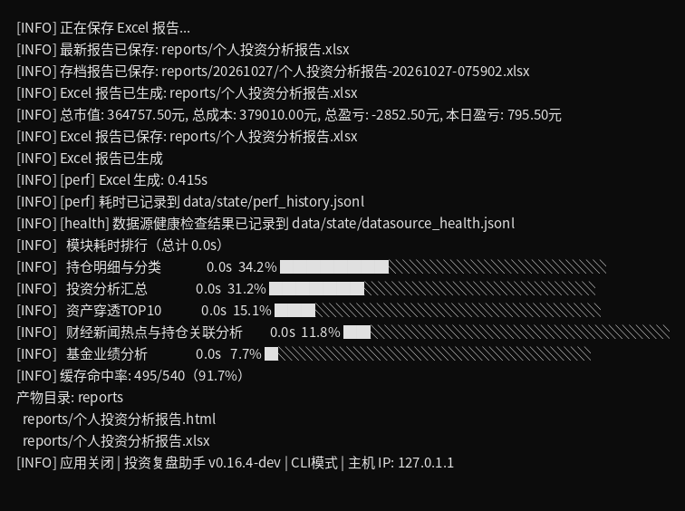

# CLI 命令行模式使用指南

CLI 命令行模式无需 TUI 菜单界面，通过命令行参数驱动，适合**定时任务、脚本化批量生成、服务器 / 无桌面环境**使用。本文从用户角度完整介绍 CLI 模式的命令结构、子命令参数与使用技巧。

> **入口**：`.venv/bin/python -m src.python.cli [全局参数] <子命令> [子命令参数]`
> **定时任务**：配合 Windows 任务计划程序 / Linux cron 自动运行，见本文 [§13 定时任务](#13-定时任务)。

---

## 目录

- [1. 命令结构](#1-命令结构) · [2. 全局参数](#2-全局参数)
- [3. `report` 子命令（生成报告）](#3-report-子命令生成报告) · [4. `cache` 子命令（缓存管理）](#4-cache-子命令缓存管理)
- [5. `whatif` 子命令（调仓 What-if 模拟）](#5-whatif-子命令调仓-what-if-模拟) · [6. `check-sources` 子命令（数据源健康检查）](#6-check-sources-子命令数据源健康检查) · [6.1 `health-history` 子命令（数据源健康历史）](#61-health-history-子命令数据源健康历史)
- [7. `view-logs` 子命令（结构化日志查看）](#7-view-logs-子命令结构化日志查看) · [8. `doctor` 子命令（系统自检）](#8-doctor-子命令系统自检)
- [9. 使用示例](#9-使用示例) · [10. 常用命令速查](#10-常用命令速查)（[10.1 TUI 菜单 → CLI 命令对照](#101-tui-菜单--cli-命令对照) · [10.2 一键快捷入口](#102-一键快捷入口)）
- [11. 退出码含义](#11-退出码含义) · [12. 最佳实践](#12-最佳实践)（[12.1 缓存预热](#121-缓存预热) · [12.2 报告输出路径](#122-报告输出路径) · [12.3 网络退避策略](#123-网络退避策略) · [12.4 性能历史自动收集](#124-性能历史自动收集) · [12.5 日志轮转](#125-日志轮转)）
- [13. 定时任务](#13-定时任务)（[13.1 Windows 任务计划程序](#131-windows-任务计划程序) · [13.2 Linux crontab](#132-linux-crontab) · [13.3 定时任务排障](#133-定时任务排障) · [13.4 任务完成通知（notify）](#134-任务完成通知notify)）
- [14. `config` 子命令（读写共享配置）](#14-config-子命令读写共享配置)

## 1. 命令结构

CLI 命令分两层：**全局参数**（位于子命令之前）+ **子命令**（`report` / `cache` / `whatif` / `config` / `check-sources` / `health-history` / `view-logs` / `doctor` / `cassettes`）。

> 其中 `cassettes` 是**开发维护命令**（列出/校验已录制的数据源真实响应，供离线回归使用），日常使用报告功能不需要它——详见 [开发者指南](../managements/developer-guide.md) → CLI 子命令。

```bash
# 查看帮助
.venv/bin/python -m src.python.cli --help

# 查看子命令帮助
.venv/bin/python -m src.python.cli report --help
```

CLI 与 TUI 共享同一套缓存、配置与报告管线，可交替使用。

---

## 2. 全局参数

| 参数 | 说明 |
|:-----|:-----|
| `--config PATH` | 配置文件路径，默认 `data/config/config.json` |
| `--output DIR` | 报告输出目录，覆盖 `config.json` 中的 `output_dir`（不存在时自动创建；支持绝对 / 相对路径） |
| `--verbose` | 详细日志输出到 stderr（默认仅写入 `logs/app.log`） |
| `--non-interactive` | 跳过首次运行交互式引导（定时任务 / 脚本使用） |
| `--experiment NAME` | 启用**实验项**功能（`experimental` 字段为真的开关；只开不关的简写），**仅本次运行生效（不写入 features.json）**。可重复指定；`NAME` 取开关名（如 `decision_reflection`）或显示名（如 `决策跨期反思闭环`），`all` = 全部启用 |
| `--feature NAME=VALUE` | 切换**任意**功能开关（`[S]` 五组 + `[C]` 两组，任一均可），**双向**（可开可关）、**仅本次运行生效（不写盘）**；`NAME` 取注册表键名，`VALUE` 写 `on`/`off`。取值写错会立即报错并列出全部可选值 |
| `--chapter KEY=on\|off` | 一次性覆盖**报告章节显隐**（仅本次运行、不写盘）；`KEY` 取章节注册表稳定键名（含智囊团生成子项），可重复。章节来源（`config.json` / `llm_settings.json` / `features.json`）由注册表分派；与 `--feature` 作用于同一子项时本参数后应用。持久化请用 `config set` |
| `--anonymize {off,code_display,full_anonymous,summary}` | 一次性覆盖**持仓匿名化模式**（仅本次运行、不写盘）；持久化请用 `config set anonymization.mode` |
| `--llm-provider-order NAME,...` | 重排 LLM 多链线路优先级并**写入** `llm_providers.json`（靠前优先），写盘后退出；`NAME` 须恰好覆盖全部现有线路（少写/多写/重复均拒绝，报错列出当前名单）。与 `--feature`（仅本次运行、不写盘）不同：本参数持久化。亦可在 TUI `[G]` → `[L]` LLM 设置 / Web 配置面板调序 |
| `--version` | 显示版本号并退出 |

> **`--experiment` 说明**：等价于在 TUI 菜单 **[S]** / Web 配置面板中临时勾选实验开关，但**只作用于当前这一次命令、不改动持久化配置**——CI / 定时任务可在不污染用户配置的前提下试用实验功能；反之，用户配置里已开启的实验开关不会被本参数关闭。
>
> ```bash
> # 单次运行启用决策跨期反思闭环（登记决策 → 真实行情结算 → 教训回灌）
> .venv/bin/python -m src.python.cli --experiment decision_reflection report --type full
>
> # 用显示名指定；已转正的开关（如正反辩论）改用 --feature 开启
> .venv/bin/python -m src.python.cli --experiment 决策跨期反思闭环 --feature llm_debate_procon=on report --type full
>


> # 本次运行启用全部实验功能
> .venv/bin/python -m src.python.cli --experiment all report --type full
> ```
>
> 取值写错会立即报错并列出全部可选值，不会静默忽略。当前可选实验功能清单见[配置指引-功能开关 §N](how-to-config.md#n-功能开关featuresjson)。

> **`--feature` 说明**：`--experiment` 的补集——它面向**全部**开关而非仅实验项，且**双向**（既能开也能关）。常用来在不动持久化配置的前提下临时关闭某个默认开启的常规开关，或复现「关掉某开关后报告长什么样」：
>
> ```bash
> # 本次运行关闭系统自检的界面入口（CLI 的 doctor 子命令本就不受该开关约束）
> `.venv/bin/python -m src.python.cli --feature report_qa=on doctor`
>
> # 本次运行关闭量化指标输出（雷达图各轴 N/A）+ 关闭数据质量仪表盘（数据源可用性矩阵不渲染区块）
> .venv/bin/python -m src.python.cli --feature cost_position=off --feature market_temperature=off report --type full
> ```
>
> 两个参数可同时使用：`--feature` 在 `--experiment` 之后应用，故 `--experiment all --feature factor_catalog=off` 表示「其余实验功能全开、只关掉因子目录」。
>
> **一次性覆写与持久化的分工**：`--experiment` / `--feature` / `--chapter` / `--anonymize` 只作用于**这一次命令**（进程退出即失效，不写盘）；要把改动落到共享配置，用 `config set`（见 [§14](#14-config-子命令读写共享配置)），或在 TUI / Web 配置面板操作。`--chapter` 与 `--feature` 的分工：前者按**章节键**（可覆盖 `config.json` 的 `enable_*`、`llm_settings.json` 的 `enabled_llm.*` 与独立章节/关联产物/智囊团子项），后者只覆盖 `features.json` 的功能开关。

---

## 3. `report` 子命令（生成报告）

| 参数 | 说明 |
|:-----|:-----|
| `--type {basic,both,full}` | `basic`=仅 Excel 报告（约 1 分钟，默认）；`both`=Excel+HTML（不含 LLM，约 2 分钟）；`full`=全量含 LLM（约 5 分钟，需 LLM 配置）。若 LLM 未配置或 `enabled_llm` 全部关闭，`full` 会在生成开始时打印 `[!]` 提示并按不含 LLM 内容生成（等同 `both`），不再静默 |
| `--history {auto,off}` | 是否获取组合历史走势：`auto`=获取，`off`=跳过。未指定时按配置 `history.fetch_mode`（默认 `auto`）。仅 `--type both` / `full` 时有效 |
| `--force-llm` | 强制重新调用 LLM API（忽略缓存），生成最新 LLM 内容（全量） |
| `--llm-module KEY` | 模块级重生成：仅强制重生成指定模块，其余照常命中缓存（可重复传参；粒度优先于 `--force-llm`）。可选键：`global_macro` 全球政经局势 / `expert_review` 智囊团深度复盘 / `health_check` 持仓体检报告 / `penetration_deep` 穿透深度分析 / `news_correlation` 财经新闻关联 / `self_review` 生成后自检 / `holding_change` 持仓变动复盘归因 |
| `--yes` | 跳过生成前 LLM 费用预估确认（仅 `--type full` 有预估与确认；`--non-interactive`/非 TTY 同样跳过；日预算超限仍直接中止） |
| `--prefer-source NAME` | 本次运行优先使用某数据源（可重复；仅排到该数据源链首，**不绕过熔断与凭据就绪预检**，不写配置） |
| `--exclude-source NAME` | 本次运行排除某数据源（可重复；用于排障复现，如「排除新浪看是否仍取到数据」）。未知名即报错并列出可用源名 |

> **生成结束会打印产物路径**：`产物目录: …` + 每个产物一行绝对路径（只列真实存在的文件），便于复制到文件管理器或交给后续脚本。**严重失败时不打印**——目录里留下的可能是上一次的产物，列出来会被误认为本次结果。



*图：一次 `report --type both` 的真实回显（虚构演示持仓）——末段是产物路径、总市值/盈亏汇总、缓存命中率与模块耗时排行。*

---

## 4. `cache` 子命令（缓存管理）

| 参数 | 说明 |
|:-----|:-----|
| `--update {basic,position,all}` | `basic`=更新基础类缓存（基金业绩、行业分类、新闻等）；`position`=更新行情类缓存（价格/指数；选项名沿用历史的 `position`）；`all`=全部更新 |
| `--clean` | 按 TTL 删除过期缓存文件 |
| `--stats` | 查看缓存状态统计（文件数、总大小、过期文件预览等） |

---

## 5. `whatif` 子命令（调仓 What-if 模拟）

对比两份持仓生成独立调仓 diff 报告（Excel 3 页签 + 指定生效日时第 4 页签「时序回测」+ HTML 双栏对比页），产物输出到报告输出目录：最新版固定名 `调仓模拟.xlsx` / `调仓模拟.html`（每次覆盖为最新对比），历史归档至 `YYYYMMDD/调仓模拟-YYYYMMDD-HHMMSS.xlsx/.html` 日期子目录（超 180 天自动清理）。默认本地计算，不并入主报告管线；申购受限提示经缓存链读限购总表（命中缓存零联网、未命中现场取一次、失败静默无提示）。

| 参数 | 说明 |
|:-----|:-----|
| `--base PATH` | 基准持仓文件（调仓前）。缺省使用 `config.json` 的 `holdings_dir` + `holdings_filename` |
| `--candidate PATH` | 目标持仓文件（调仓后/假设），**必填** |
| `--effective-date YYYY-MM-DD` | 调仓生效日（可选）。指定后 opt-in 联网取生效日后行情，追加时序回测（区间/年化收益、波动率、夏普、最大回撤）。格式在参数解析期严格校验（YYYY-MM-DD；非法如 `20260101` 直接报错退出，不进业务链） |

> 指定 `--effective-date` 时联网取历史做假设推演（不构成收益承诺），数据不足时回测降级不阻塞主报告。

---

## 6. `check-sources` 子命令（数据源健康检查）

测试各行情数据源联通性并报告延迟（**含财报域两源**：DataSinking 财报取数 + 巨潮资讯 orgId 解析；缺 key 的源显示 ⏭️ 跳过态），无需生成报告：

```bash
.venv/bin/python -m src.python.cli check-sources
```

### 6.1 `health-history` 子命令（数据源健康历史）

查看**最近 N 次采集**的数据源健康记录（与 TUI `[H]`、Web `/api/health/history` 同一份聚合，字段一致）；无需配置，只读 `data/state/` 下的健康快照。

| 参数 | 说明 |
|:-----|:-----|
| `--limit N` | 显示最近多少次（默认 10，最小 1） |
| `--json` | 以 JSON 输出，供脚本消费（字段：`timestamp` / `report_type` / `holdings_count` / `total` / `ok_count` / `fail_count` / `failed_sources`） |

```bash
# 最近 10 次
.venv/bin/python -m src.python.cli health-history

# 最近 30 次，失败源一起看
.venv/bin/python -m src.python.cli health-history --limit 30

# 脚本消费
.venv/bin/python -m src.python.cli health-history --json | jq '.[-1].failed_sources'
```

---

## 7. `view-logs` 子命令（结构化日志查看）

按级别/行数/时间范围查看最近运行日志，无需生成报告，也**无需配置**（读取逻辑不依赖 config——配置损坏时仍可查日志诊断）。日志路径取自运行期 `logs/app.log`。

| 参数 | 说明 |
|:-----|:-----|
| `--level {DEBUG,INFO,WARNING,ERROR,CRITICAL}` | 最小级别阈值，只显示该级别及以上的日志 |
| `--lines N` | 读取末尾行数上限（默认 5000） |
| `--since PREFIX` | 只显示时间前缀 >= 该值的记录（如 `2026-08-16 12:00`） |
| `--until PREFIX` | 只显示时间前缀 <= 该值的记录 |

```bash
# 查看最近 200 行
.venv/bin/python -m src.python.cli view-logs --lines 200

# 只看 ERROR 及以上
.venv/bin/python -m src.python.cli view-logs --level ERROR

# 查看指定时间段
.venv/bin/python -m src.python.cli view-logs --since "2026-08-16 12:00" --until "2026-08-16 13:00"
```

每条输出格式：`time [LEVEL] message`，多行正文（如 traceback）缩进展示。

---

## 8. `doctor` 子命令（系统自检）

一键盘点运行环境，分组报告 **环境 / 配置 / 目录 / 日志与缓存 / 功能开关 / 数据源适配 / 数据源凭据 / 数据源** 八组检查结果，**失败项附可执行修复建议**。适合新机部署、报告跑不起来、怀疑配置损坏时先跑一遍。

```bash
.venv/bin/python -m src.python.cli doctor
```

| 参数 | 说明 |
|:-----|:-----|
| `--offline` | 跳过联网检查（数据源连通性），纯本地自检、秒级返回 |
| `--timeout SECONDS` | **网络检查整体**的耗时预算（默认 8 秒；对全部联网检查共用一个预算，防止慢速数据源拖住自检） |

```bash
# 纯本地自检（不联网）
.venv/bin/python -m src.python.cli doctor --offline

# 放宽联网检查预算到 20 秒
.venv/bin/python -m src.python.cli doctor --timeout 20
```

**与其它子命令的两点不同**：

1. **无需配置**——自检在加载配置**之前**执行。配置损坏正是它要诊断的场景，因此不会因配置读不出来而拒绝运行。
2. **不受开关约束**——`doctor` 子命令始终可用，无需任何开关。TUI `[T]` / Web「系统自检」卡恒上屏，功能开关中不再有自检项。

**退出码**：`0` = 全部检查通过；`1` = 自检跑完了但**存在失败项**（注意：这不是「命令失败」，而是一条诊断结论，脚本可用它判定环境是否可用）。

> 日常也可从 TUI 菜单 **D → T**** 或 Web「系统自检」卡片触发同一套检查，三端共用 `core/doctor.py`。

---

## 9. 使用示例

```bash
# 生成全量报告，强制重新调用 LLM
.venv/bin/python -m src.python.cli --verbose report --type full --history auto --force-llm

# 排障：本次运行只用腾讯源、并排除新浪源（不写配置，退出即恢复）
.venv/bin/python -m src.python.cli report --prefer-source tencent --exclude-source sina

# 基础 Excel 报告，输出到指定目录
.venv/bin/python -m src.python.cli --output D:/my_reports report --type basic

# 使用自定义配置文件
.venv/bin/python -m src.python.cli --config D:/config/my_config.json cache --stats

# 调仓 What-if：基准用配置默认持仓，目标指定另一份文件
.venv/bin/python -m src.python.cli whatif --candidate D:/holdings/调仓方案.xlsx

# 调仓 What-if：显式指定两份持仓
.venv/bin/python -m src.python.cli whatif --base D:/holdings/当前.xlsx --candidate D:/holdings/方案B.xlsx

# 调仓 What-if：指定生效日，追加时序回测
.venv/bin/python -m src.python.cli whatif --base D:/holdings/当前.xlsx --candidate D:/holdings/方案B.xlsx --effective-date 2026-07-01

# 更新全部缓存
.venv/bin/python -m src.python.cli cache --update all

# 查看缓存状态
.venv/bin/python -m src.python.cli cache --stats

# 查看最近 200 行运行日志（只看 ERROR）
.venv/bin/python -m src.python.cli view-logs --lines 200 --level ERROR

# 查看性能历史趋势
.venv/bin/python scripts/perf-history.py
```

---

## 10. 常用命令速查

| 用途 | 命令 |
|:-----|:-----|
| 生成基础 Excel 报告 | `.venv/bin/python -m src.python.cli report --type basic` |
| 生成全系列报告（不含 LLM） | `.venv/bin/python -m src.python.cli report --type both --history auto` |
| 生成全量完整报告 | `.venv/bin/python -m src.python.cli report --type full --history auto` |
| 更新全部缓存 | `.venv/bin/python -m src.python.cli cache --update all` |
| 更新基础类缓存 | `.venv/bin/python -m src.python.cli cache --update basic` |
| 更新行情类缓存 | `.venv/bin/python -m src.python.cli cache --update position` |
| 清理过期缓存 | `.venv/bin/python -m src.python.cli cache --clean` |
| 查看缓存状态 | `.venv/bin/python -m src.python.cli cache --stats` |
| 数据源健康检查 | `.venv/bin/python -m src.python.cli check-sources` |
| 查看最近运行日志 | `.venv/bin/python -m src.python.cli view-logs --level WARNING` |
| 系统自检（一键体检） | `.venv/bin/python -m src.python.cli doctor --offline` |
| 查看当前生效配置 | `.venv/bin/python -m src.python.cli config list` |
| 持久化关闭某章节 | `.venv/bin/python -m src.python.cli config set enable_news false` |
| 一次性匿名生成 | `.venv/bin/python -m src.python.cli --anonymize full_anonymous report --type both` |
| 一次性关闭某章节 | `.venv/bin/python -m src.python.cli --chapter enable_news=off report --type both` |
| 查看性能历史趋势 | `.venv/bin/python scripts/perf-history.py` |

### 10.1 TUI 菜单 → CLI 命令对照

TUI 菜单与 CLI 子命令落到**同一个业务编排函数**（`report/orchestrator.py::generate_report` 等），差别只在入参从哪来：TUI 在菜单里问，CLI 用参数传。下表对照**生成类菜单**（E/B/L/W）与配置类菜单；缓存管理（`[1]`~`[3]`）的等价见上方「常用命令速查」。

配置类菜单的 CLI 覆盖分**一次性**与**持久化**两档：一次性用全局参数（`--chapter` / `--feature` / `--anonymize` / `--output` / `--llm-provider-order`），持久化用 `config set`（`[C]`/`[S]`/`[G]` 的写盘面）。`[R]` 刷新配置对 CLI 无意义（每次命令启动即读最新配置）；诊断四项中 `V`/`H`/`T` 分别对应 `view-logs` / `health-history` / `doctor`，`L` 日志设置用 `config set logging.*`；报告追问 `[Q]` 仅 TUI / Web 提供（CLI 无对话式交互面）。

| TUI 菜单 | CLI 等价命令 |
|:---------|:-------------|
| **[E]** 生成基础报告（仅 Excel） | `report --type basic` |
| **[B]** 生成标准报告（Excel+HTML，按章节配置） | `report --type both --history auto` |
| **[L]** 生成完整报告（Excel+HTML，含 LLM） | `report --type full --history auto` |
| **[W]** 调仓 What-if 模拟 | `whatif --base <调仓前.xlsx> --candidate <调仓后.xlsx>` |
| **[C]** 报告章节显隐 | 一次性：`--chapter enable_news=off`；持久化：`config set enable_news false` / `config set enabled_llm.health_check false` |
| **[S]** 报告章节内容呈现 | 一次性：`--feature cost_position=off`；持久化：`config set cost_position false` |
| **[G]** 全局设置 | 输出目录 `--output DIR`；多链调序 `--llm-provider-order`；持仓/基准/匿名化等 `config set holdings_dir …` / `--anonymize …` |

以 `[L]` 为例，逐项拆开看更直观：

| `[L]` 触发时 TUI 的行为 | CLI 对应参数 | 说明 |
|:------------------------|:-------------|:-----|
| 生成类型固定为 `full` | `--type full` | 报告类型默认是 `basic`，务必显式指定 |
| 询问「是否获取组合历史走势数据」 | `--history auto` / `--history off` | 省略 `--history` 时按 `config.json` 的 `history.fetch_mode` 解析（`off` 跳过，`auto`/`prompt` 均视为获取） |
| 询问「是否强制重新生成 LLM 内容」 | `--force-llm` | 不加则复用 LLM 缓存 |
| 二段追问「哪些模块需要强制」（回车=全部） | `--llm-module KEY`（可重复） | 不选则全量重新生成（与 `--force-llm` 等价） |
| 询问「本次生成费用预估如上，确认继续？」（y/N） | `--yes` | 预估行恒打印（今日已花费/日预算同屏；带 `--force-llm`/`--llm-module` 时预估按所选范围重估并拆行显示「其中 N 个模块重新生成」）；脚本与定时任务必须带 `--yes` 或 `--non-interactive` |
| 超日预算时询问「用已有结果继续 / 中止」 | —（非交互直接中止，退出码 2） | 上限由 `llm_settings.json → daily_cost_limit` 配置（本币单值，默认 `0` 不启用）；交互终端保留询问，该路径会清空本次重新生成范围 |
| 首次运行交互式引导 | `--non-interactive` | 跳过引导，定时任务/脚本建议带上 |
| 结束打印 LLM 会话用量 | —（打印耗时汇总） | 两条路径的收尾输出不同，不影响产物 |

所以 `[L]` 的完整等价命令是：

```bash
.venv/bin/python -m src.python.cli --non-interactive report --type full --history auto
# 若要连同「强制重生成 LLM」一起答上（等价于询问时答 y）：
.venv/bin/python -m src.python.cli --non-interactive report --type full --history auto --force-llm
```

两点需要留意（TUI 与 CLI 在这些情况下的行为差异，均不影响报告内容）：

1. **`history.fetch_mode = "prompt"` 时**：TUI 会停下来问；CLI 省略 `--history` 时按「获取」处理（非交互场景无从询问）。
2. **`enable_history = false` 时**：历史走势整体不获取，此时加 `--history auto` 也不会生效——外层开关优先于本参数。TUI 与 CLI 行为一致。

### 10.2 一键快捷入口

若只想要 `[L]` 这一件事，`scripts/llm.sh`（Linux/macOS）与 `scripts/llm.ps1`（Windows）把子命令与报告类型写死在脚本里，免去每次敲 `report --type full`：

```bash
./scripts/llm.sh                  # 生成完整报告（含 LLM）
./scripts/llm.sh --force-llm      # 强制重新调用 LLM，跳过缓存
./scripts/llm.sh --history off    # 本次不获取组合历史走势
```

追加的参数即 `report` 的报告级参数。需要全局参数（`--config` / `--output` / `--experiment` / `--feature`）时仍走 `cli.sh` / `cli.ps1`——它们必须写在子命令之前。

其余菜单项（配置类、缓存类、日志/健康/自检）在 CLI 侧均有对应命令或子命令，见上方速查表、§10.1 与各节说明。

---

## 11. 退出码含义

| 退出码 | 含义 | 说明 |
|:------:|:-----|:-----|
| 0 | 成功 | 报告生成或缓存操作全部成功 |
| 1 | 部分失败 | 部分模块失败（如 LLM key 缺失降级），主任务完成 |
| 2 | 严重错误 | 任务无法执行（如持仓文件不存在、配置格式错误） |
| 130 | 用户中断 | Ctrl+C 手动终止 |

| 场景 | 退出码 | 处理建议 |
|:-----|:------:|:---------|
| 正常完成 | 0 | 无需处理 |
| LLM key 缺失降级 | 1 | 如需 LLM 内容，配置 `llm_key.json` |
| 部分数据源失败 | 1 | 检查网络，下次调度自动恢复 |
| 持仓文件不存在 | 2 | 检查 `config.json` 中 `holdings_dir` / `holdings_filename` 配置 |
| 配置格式错误 | 2 | 运行 `.venv/bin/python -c "import json; json.load(open('data/config/config.json'))"` 检查；或先跑 `doctor`（无需配置即可运行）定位 |
| 自检有失败项 | 1 | `doctor` 子命令专用：命令跑完了但检查未全过，按失败项附带的修复建议处理 |
| 用户中断 | 130 | 手动终止，无需处理 |

---

## 12. 最佳实践

### 12.1 缓存预热

首次运行或新增持仓后，建议先更新缓存再生成报告：

```bash
# 先更新缓存，再生成报告
.venv/bin/python -m src.python.cli cache --update all
.venv/bin/python -m src.python.cli --output ./reports report --type basic
```

### 12.2 报告输出路径

通过 `--output DIR` 全局参数指定报告输出目录，覆盖 `config.json` 中的 `output_dir` 配置：

```bash
# 输出到默认 reports/ 目录（使用 config.json 配置）
.venv/bin/python -m src.python.cli report --type full --history auto

# 输出到指定目录
.venv/bin/python -m src.python.cli --output D:/backup/reports report --type basic

# 输出到网络共享目录（需确保程序有写入权限）
.venv/bin/python -m src.python.cli --output \\NAS\invest\reports report --type basic
```

> 定时任务中建议使用绝对路径，避免因工作目录不确定导致的路径问题。

### 12.3 网络退避策略

Provider Chain 内置同源瞬时失败重试 + 熔断机制，网络临时故障时自动降级使用过期缓存：

- 短时网络抖动 → 同源额外重试 1 次（退避 0.6s 起指数增长 + 抖动），仍失败才落下一槽
- 数据源持续不可用 → 熔断器开启 → 使用过期缓存
- 报告在无网络环境下降级生成（exit=1，部分数据为空）

### 12.4 性能历史自动收集

每次 CLI 报告生成时，系统自动记录性能数据到 `data/state/` 目录：

| 文件 | 内容 | 查看方式 |
|:-----|:------|:---------|
| `perf_history.jsonl` | 各阶段耗时（行情/数据准备/HTML/Excel/LLM 等），含版本号和持仓数量 | `.venv/bin/python scripts/perf-history.py` |
| `datasource_health.jsonl` | 全量数据源 HTTP 连通性检查结果 + 延迟 | 同上命令 |

这些记录自动积累，可用于跨版本性能退化检测和异常波动排查，无需手动触发。

趋势报告开头输出「总体分位概览」：样本数 / 平均 / 中位 / P95 / P99 / 最长。P95、P99 为最近秩分位，统一表述为 **「95% 的报告在 Xs 内完成，99% 的报告在 Ys 内完成」**（概览口径行与分组段同一句式），可据此判断常见与最坏等待时间。

### 12.5 日志轮转

应用日志已自动轮转（`logs/app.log`，单文件最大 10 MB，保留 5 份备份），**无需额外配置**。

定时任务的 cron/stderr 日志建议自行配置 logrotate：

```bash
# /etc/logrotate.d/investor-review
/home/user/investor-review/logs/cron.log {
    monthly
    rotate 6
    compress
    missingok
    notifempty
}
```

---

## 13. 定时任务

CLI 模式配合操作系统定时任务可实现无人值守的自动报告生成（定时驱动报告 / 更新缓存），无需人工操作 TUI 菜单。定时任务中建议使用**绝对路径**（避免工作目录不确定）与 `--non-interactive`（跳过首次运行引导）。

### 13.1 Windows 任务计划程序

#### 基础配置（Windows）

使用 `schtasks` 命令创建定时任务，需指定 Python 解释器完整路径：

```batch
:: 每日 16:00 生成全量报告（盘后）
schtasks /CREATE /SC DAILY /TN "InvestReport" /TR "D:\path\to\investor-review\.venv\Scripts\python.exe D:\path\to\investor-review\src\python\cli\cli.py report --type full --history auto" /ST 16:00 /F

:: 每周一早 9:00 更新全部缓存
schtasks /CREATE /SC WEEKLY /D MON /TN "InvestCacheUpdate" /TR "D:\path\to\investor-review\.venv\Scripts\python.exe D:\path\to\investor-review\src\python\cli\cli.py cache --update all" /ST 09:00 /F
```

#### PowerShell 包装脚本（推荐）

推荐使用 PowerShell 包装脚本，方便日志记录和错误处理（自行创建 `scripts/scheduled_report.ps1`）：

```powershell
param(
    [string]$ReportType = "full",
    [string]$OutputDir = "reports"
)

$ProjectRoot = "D:\path\to\investor-review"
$LogFile = Join-Path $ProjectRoot "logs\cron.log"
$Timestamp = Get-Date -Format "yyyy-MM-dd HH:mm:ss"

try {
    $env:PYTHONUNBUFFERED = "1"
    $result = & "$ProjectRoot\.venv\Scripts\python.exe" -m src.python.cli --output $OutputDir report --type $ReportType --history auto 2>&1
    $exitCode = $LASTEXITCODE

    "$Timestamp [exit=$exitCode] $result" | Out-File $LogFile -Append -Encoding UTF8

    if ($exitCode -gt 1) {
        exit $exitCode  # 严重错误时任务计划程序可配置重试
    }
} catch {
    "$Timestamp [ERR] $_" | Out-File $LogFile -Append -Encoding UTF8
    exit 2
}
```

#### 防重入

任务计划程序本身提供防重入（上一个实例未完成时不启动新实例），但建议配合锁文件：

```batch
:: 锁文件 + 超时退避
schtasks /CREATE /SC DAILY /TN "InvestReport" /TR "powershell -NoProfile -Command \"if (-not (Test-Path '$env:TEMP\invest.lock')) { New-Item '$env:TEMP\invest.lock' -Force | Out-Null; try { D:\path\to\investor-review\.venv\Scripts\python.exe -m src.python.cli report --type full --history auto } finally { Remove-Item '$env:TEMP\invest.lock' -ErrorAction SilentlyContinue } }\"" /ST 16:00
```

### 13.2 Linux crontab

#### 基础配置（Linux）

```bash
# 编辑 crontab
crontab -e

# 每日 16:00 生成全量报告
0 16 * * * cd /home/user/investor-review && .venv/bin/python -m src.python.cli report --type full --history auto >> logs/cron.log 2>&1

# 每周一早 9:00 更新全部缓存
0 9 * * 1 cd /home/user/investor-review && .venv/bin/python -m src.python.cli cache --update all >> logs/cron.log 2>&1

# 每月 1 号清理缓存
0 10 1 * * cd /home/user/investor-review && .venv/bin/python -m src.python.cli cache --clean >> logs/cron.log 2>&1
```

#### flock 防重入

对于耗时较长的 `report --type full`，使用 `flock` 防止并发：

```bash
# 使用 flock 锁文件防重入
0 16 * * * cd /home/user/investor-review && flock -n /tmp/invest.lock .venv/bin/python -m src.python.cli report --type full --history auto >> logs/cron.log 2>&1
```

### 13.3 定时任务排障

**检查日志**：

```bash
# 查看应用日志（最近 20 行）
tail -20 logs/app.log

# 查看 cron 输出
tail -20 logs/cron.log
```

**手动测试**：先手动执行确认命令正常工作：

```bash
# 快速验证
.venv/bin/python -m src.python.cli cache --stats
.venv/bin/python -m src.python.cli report --type basic
```

**常见问题**：

| 问题 | 排查 |
|:-----|:-----|
| 定时任务未执行 | 检查任务计划程序历史记录 / cron 服务状态 |
| 报告为空 | 检查持仓文件路径和格式 |
| 缓存未更新 | 检查网络连接，`cache --stats` 查看缓存状态 |
| Python 找不到模块 | 确保工作目录为项目根目录（`cd` 到 `investor-review/`） |

---

### 13.4 任务完成通知（notify）

cron / 任务计划运行只有退出码，失败也无人知晓。config.json `notify` 节可配置报告生成完成后的通知推送（也可由 Web 配置面板/TUI 同份配置编辑）：

```jsonc
"notify": {
  "on_success": false,     // 成功也发送（失败/部分失败必发，不受此开关影响）
  "webhook_url": "",       // webhook 地址（HTTP POST JSON），空=不启用；URL 常含凭据，日志只记域名
  "email": {               // SMTP 邮件（smtp_host 与 to 均非空才启用）
    "smtp_host": "", "smtp_port": 465, "use_ssl": true,
    "username": "", "password": "", "to": ""
  },
  "desktop": false,         // 桌面通知（Linux notify-send，未安装记日志跳过）
  "timeout_seconds": 10     // 通道超时（秒）
}
```

- **触发**：退出码非 0（部分失败/严重错误）**必发**；成功仅 `on_success: true` 时发
- **默认关**：无 `notify` 节或全部通道未配置 → 静默跳过，不影响任何其他行为
- **载荷**：报告类型、退出码、产物路径（latest 最新版名按结果标志列示）、错误数与明细（截断）、数据降级摘要（数据状态跟踪器，最新在前按源去重）
- **尽力而为**：单次尝试无重试；单通道失败隔离，任何通道失败只记日志（`[notify]` 前缀）、**绝不改变退出码**；webhook URL 异常消息落日志前掩码只留域名

---

- [快速开始](how-to-start.md)「方式三」—— CLI 启动简介
- [TUI 菜单操作手册](how-to-use-tui-menu.md) —— TUI 等效操作（各菜单详解）
- [常规配置指引](how-to-config.md) —— 全部配置项语义与默认值

---

**相关手册**：[← TUI 菜单操作手册](how-to-use-tui-menu.md) · [Web 浏览器模式 →](how-to-use-web-mode.md) · [手册总索引](README.md)
同主题：[常规配置指引](how-to-config.md) · [数据与备份](data-and-backup.md)

---

## 14. `config` 子命令（读写共享配置）

`config` 用于在命令行**查看与持久化修改**共享配置，写盘路径与 TUI / Web 配置面板**同一编辑层**（`config/edit_ops.py`）：白名单校验、写前 `.bak` 备份、注释保留、缓存即时失效。适用于无桌面 / 服务器 / 自动化场景。

| 子命令 | 用途 |
|:--|:--|
| `config list [--json]` | 列出白名单键与**当前生效值**（含 `scheduler.*`；动作型键单列） |
| `config get KEY` | 读取单个键的当前生效值（JSON 输出） |
| `config set KEY VALUE [--dry-run]` | 写入单个键（`--dry-run` 只校验并输出归一化值，不落盘） |

**取值写法**：布尔用 `on`/`off`（也接受 `true/false/1/0`）；整数直接写数字；枚举写可选值；`scheduler.weekdays` 用逗号分隔（`0=周一`）。写入失败（未知键、取值越界、动作型键）退出码 2，并给出可操作提示。

```bash
# 查看/读取
.venv/bin/python -m src.python.cli config list
.venv/bin/python -m src.python.cli config list --json          # 供脚本消费
.venv/bin/python -m src.python.cli config get holdings_dir

# 持久化修改（写盘前自动 .bak）
.venv/bin/python -m src.python.cli config set holdings_dir /data/holdings
.venv/bin/python -m src.python.cli config set enable_news off
.venv/bin/python -m src.python.cli config set anonymization.mode summary
.venv/bin/python -m src.python.cli config set logging.level DEBUG
.venv/bin/python -m src.python.cli config set scheduler.enabled on
.venv/bin/python -m src.python.cli config set scheduler.weekdays 0,1,2,3,4
.venv/bin/python -m src.python.cli config set holdings_filename 持仓.xlsx --dry-run
```

**覆盖范围（白名单）**：持仓目录/文件名、报告输出目录、顶层章节开关（`enable_*`）、匿名化模式、对比指数池（动作型，见下）、`enabled_llm.*`、全部功能开关、LLM 调优参数、`logging.*`，以及 `scheduler.*` 四个字段。

**动作型键不提供 `set`**：`comparison_indices`（增/删/重置）请用 TUI `[G]` / Web 配置面；`llm_providers.priority`（重排）请用 `--llm-provider-order`。密钥（`llm_key.json` / `data_key.json`）**不在**配置编辑白名单内，请按手册直接维护文件或环境变量。

**一次性 vs 持久化**：`config set` 是**持久化**写入；只想改这一次命令的产物，用全局参数 `--chapter` / `--feature` / `--anonymize`（零写盘）。`config list/get` 显示的是**当前生效值**——若同一条命令带了 `--chapter` / `--feature` / `--anonymize`，会看到覆写后的值。

**调度说明**：`config set scheduler.*` 只写配置；实际触发由 **Web 服务常驻调度线程**执行（需 Web 进程在运行）。纯 headless 场景继续用 cron / 任务计划程序调用 `report`（见 [§13](#13-定时任务)）。
